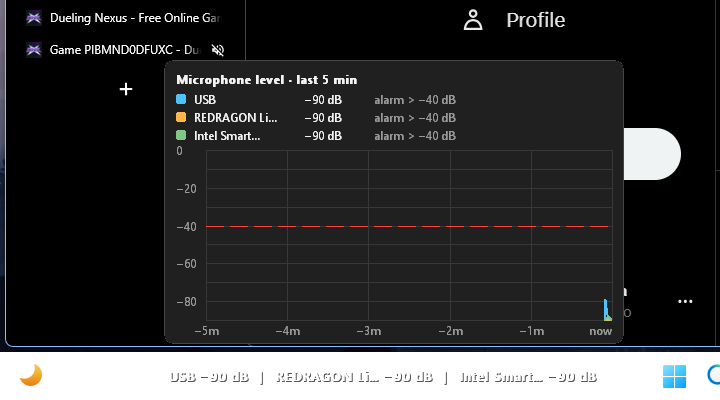
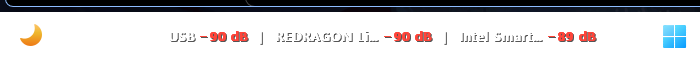

# mic-db-taskbar

A tiny Windows 11 app that shows the live level of every microphone, in dBFS, right on the
taskbar, immediately to the right of the Widgets (weather) button.


- One readout per active capture device, side by side: `USB −42 dB │ Intel Smart… −61 dB`.
- Level = RMS over 100 ms windows from a WASAPI shared-mode capture stream per device,
  smoothed (fast attack, slow release), refreshed at 10 Hz, floored at −90 dB.
- **History chart on hover:** rest the mouse on the readout for ~0.3 s and a popup shows
  the last 5 minutes as a line chart, one line per mic, with the current value and the
  alarm threshold (dashed). History is kept in RAM only (2 samples/s, 5 min) and is never
  written to disk; it is lost when the app exits.
- **Alarm:** a mic's value turns red when it stays above the threshold (default −40 dB) for
  at least 1 s, and goes back to normal 1 s after it drops, so coughs and bumps don't
  flash it.
- Devices are re-enumerated every 3 s, so plugging/unplugging a mic just works.
- Click-through, borderless, topmost overlay; per-monitor DPI aware; follows the light/dark
  system theme; hides itself when a fullscreen app is in front or the taskbar auto-hides.
- Single small exe, no console, no tray icon, ~0.5 % of one core.





## Never in the way of other apps

- Capture is **shared mode only** (`AUDCLNT_SHAREMODE_SHARED`, only the event-callback
  flag). The app never uses exclusive mode and never changes volume, format or the default
  device, so Teams, Zoom, OBS, recorders etc. keep working on the same mics.
- If another app holds a mic in exclusive mode, or the device disappears, that readout
  shows `—` and is retried every 15 s; nothing errors or spins.
- **Bluetooth mics are skipped by default:** opening a Bluetooth headset's mic switches it
  to the low-quality hands-free profile for as long as the stream is open. Set
  `include_bluetooth = true` if you want them anyway.

## Install

Download `mic-db-taskbar.exe` from the
[latest release](https://github.com/LautaroLasorsa/mic-db-taskbar/releases/latest), put it
somewhere permanent (e.g. `%LOCALAPPDATA%\Programs\mic-db-taskbar\`) and run it.

Or build it yourself (Rust 1.88+):

```powershell
cargo install --git https://github.com/LautaroLasorsa/mic-db-taskbar
mic-db-taskbar
```

## Command line

```text
mic-db-taskbar                  run the overlay (only one instance runs)
mic-db-taskbar --autostart on   start with Windows (HKCU\...\CurrentVersion\Run)
mic-db-taskbar --autostart off  remove the autostart entry
mic-db-taskbar --list           list capture devices: shown/skipped, wired/bluetooth
mic-db-taskbar --stop           close the running instance
```

`--autostart on` registers the path of the exe you run it from, so run it from the installed
location.

## Configuration (optional)

Create `mic-db-taskbar.toml` next to the exe, or `%APPDATA%\mic-db-taskbar\config.toml`.
It is read at startup (`--stop` and start again to apply changes). All keys are optional;
device keys are case-insensitive substrings of the Windows device name (see `--list`).

```toml
# Calibration added to every reading, in dB.
offset_db = 0

# Alarm threshold (compared with the displayed value, i.e. after offset_db).
alarm_db = -40.0

# Never open these devices.
exclude = ["Stereo Mix"]

# Bluetooth mics are skipped unless this is true (see above).
include_bluetooth = false

# Short labels.
[labels]
"Realtek" = "Int"
"REDRAGON" = "Cam"

# Per-device alarm thresholds.
[alarms]
"USB" = -30.0
```

Without a label, the name inside the parentheses of the Windows device name is used
(`Microphone (USB Audio Device)` → `USB`), truncated to 12 characters.

## Notes and limitations

- Windows shows the "microphone in use" indicator while the app runs, because it really
  opens a capture stream on each mic (the peak meter API reads 0 without one).
- Only the primary taskbar is used. The Widgets button is found through UI Automation
  (`AutomationId = WidgetsButton`); if it is hidden or not found, the readout sits at the
  taskbar's left edge. Designed for the default centered layout, where the left side of the
  taskbar is free; on a left-aligned taskbar it may overlap app buttons.
- The readout is an overlay, not part of explorer: it re-asserts topmost every second and
  follows explorer restarts (`TaskbarCreated`). It stays click-through; the hover chart is
  detected by polling the cursor position, so the taskbar underneath remains usable.

## License

MIT
